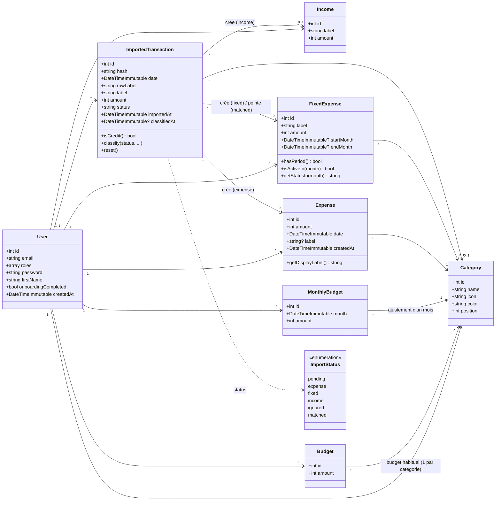
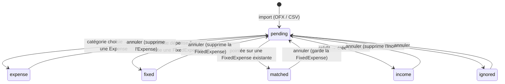

# Buddy — diagrammes UML

Montants en centimes (`int`). Toutes les données appartiennent à un `User` (suppression en cascade).

## 1. Modèle de données (entités Doctrine)

Règles notables :
- **Budget effectif d'un mois** = `MonthlyBudget` du mois s'il existe (0 = pas de budget ce mois-ci), sinon `Budget` habituel.
- **Dépense fixe active** un mois donné si `startMonth ≤ mois ≤ endMonth` (bornes facultatives).
- **Déduplication des imports** : `hash` unique par utilisateur (FITID OFX, sinon date + montant + libellé + rang).

## 2. Architecture applicative

```mermaid
classDiagram
    direction TB

    namespace Controllers {
        class SecurityController
        class OnboardingController
        class DashboardController
        class ExpenseController
        class PlanningController
        class StatsController
        class ImportController
        class MenuController
    }

    namespace Services {
        class MonthSummary {
            +compute(user, month) array
        }
        class StatsReport {
            +build(user, month) array
            +impact(user, month) array
        }
        class PlanningForms {
            +handle(section, user, request) array
        }
        class CategoryDefaults
    }

    namespace Import {
        class StatementParser {
            +parse(content, filename) array
        }
        class LabelCleaner {
            +clean(raw) string
        }
        class CategorySuggester {
            +suggest(tx, categories) Category
        }
        class FixedExpenseMatcher {
            +match(tx) array
        }
        class TransactionImporter {
            +import(user, content, filename) array
            +toExpense() / toFixedExpense() / toIncome()
            +matchFixedExpense() / ignore() / undo()
        }
    }

    namespace Transverse {
        class OwnerVoter
        class OnboardingSubscriber
        class AppExtension
        class RecleanImportLabelsCommand
    }

    DashboardController --> MonthSummary
    PlanningController --> MonthSummary
    PlanningController --> PlanningForms
    PlanningController --> StatsReport
    OnboardingController --> PlanningForms
    StatsController --> StatsReport
    StatsReport --> MonthSummary
    SecurityController --> CategoryDefaults

    ImportController --> TransactionImporter
    ImportController --> CategorySuggester
    ImportController --> FixedExpenseMatcher
    TransactionImporter --> StatementParser
    TransactionImporter --> LabelCleaner
    RecleanImportLabelsCommand --> LabelCleaner

    ExpenseController ..> OwnerVoter : IsGranted
    ImportController ..> OwnerVoter : IsGranted
```

## 3. Cycle de vie d'une opération importée

